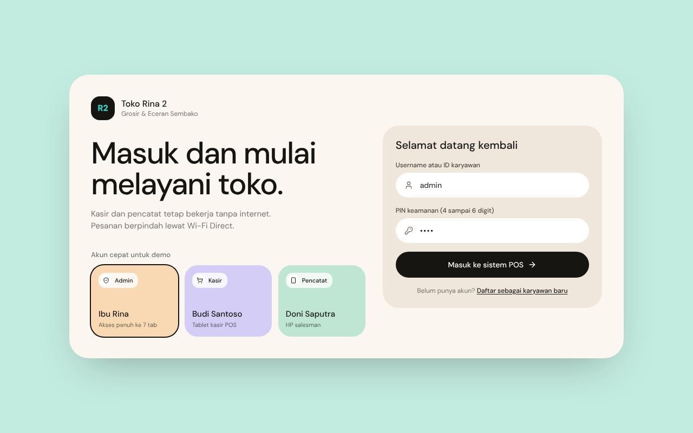

# Full-Stack — POS Toko Rina 2

<div align="center">
  <a href="https://claude.ai/artifact/Gjo2vXWeQAat2WSt6yMF7N" target="_blank">
    
  </a>
  <br />
  <a href="https://claude.ai/artifact/Gjo2vXWeQAat2WSt6yMF7N" target="_blank">
    
  </a>
  <a href="https://cheerful-longma-0f7792.netlify.app" target="_blank">
    
  </a>
</div>

---

- [frontend](frontend/README.md): antarmuka yang dipakai petugas dan kasir.
- [backend](backend/README.md): API dan aturan yang menentukan apakah pesanan dapat disimpan atau diproses.

Keduanya terhubung melalui HTTP API dan Local Socket. Frontend tidak mengimpor kode internal backend, dan backend tidak memuat komponen tampilan.

Kontrak yang melintasi batas aplikasi disimpan di [contracts/api](../contracts/api/README.md). Dependensi, environment, tes, dan cara menjalankan tiap aplikasi dikelola pada folder aplikasi masing-masing.

Pilihan teknologi dari Project Plan adalah **React / Vite / Tailwind CSS / Capacitor** untuk frontend serta **Node.js Express / Joi / Knex / SQLite3** untuk backend.

---

## Tampilan Terang (Bento) & Live Demo

Antarmuka kini memiliki tema **terang bergaya editorial bento**: latar mint, kanvas krem, kartu putih bersudut membulat, tombol dan tab berbentuk pill, serta aksen turquoise. Tema ini menggantikan tema gelap navy pada versi awal. Seluruh logika, alur kerja, dan API tidak berubah.

| | |
| --- | --- |
| **Live demo (terang)** | [Buka demo](https://claude.ai/artifact/Gjo2vXWeQAat2WSt6yMF7N) |
| **Demo tema gelap (versi awal)** | [cheerful-longma-0f7792.netlify.app](https://cheerful-longma-0f7792.netlify.app) |
| **Font** | DM Sans (antarmuka) dan JetBrains Mono (angka nota) |
| **Berkas tema** | `frontend/src/styles/ipos-theme.css`, `components.css`, `index.css` |

### Cara mencoba live demo
Demo berjalan penuh di browser tanpa backend (data disimpan di `localStorage` browser Anda). Aplikasi dimulai dari **layar login**: klik salah satu kartu **akun cepat** untuk mengisi username dan PIN, lalu tekan **Masuk ke sistem POS**. Sesi tetap tersimpan saat halaman dimuat ulang; tekan ikon **keluar** di sidebar untuk kembali ke layar login. Pengguna baru juga bisa mendaftar lewat **Daftar sebagai karyawan baru** (berstatus *pending* sampai disetujui Admin).

| Role | Username | PIN | Catatan |
| --- | --- | --- | --- |
| Admin (Ibu Rina) | `admin` | `1234` | Akses penuh 7 tab |
| Kasir (Budi Santoso) | `budi` | `1111` | Tablet kasir, Tab 7 tersembunyi |
| Pencatat (Doni Saputra) | `doni` | `2222` | Berstatus *pending*, setujui dulu lewat Admin di Tab Pengaturan |

Tampilan terbaik pada layar tablet landscape (≥ 1024 px). Tampilan Pencatat dirancang untuk HP portrait.

### Palet warna tema terang
| Token | Warna | Pemakaian |
| --- | --- | --- |
| `--ipos-bg-main` | `#c3ece0` | Latar luar aplikasi (mint) |
| `--ipos-bg-panel` | `#efe7dc` | Sidebar (beige) |
| `--ipos-bg-canvas` | `#fbf7f0` | Kanvas konten (krem) |
| `--ipos-bg-card` | `#ffffff` | Kartu |
| `--ipos-text` | `#161512` | Teks utama |
| `--ipos-accent` / `--ipos-accent-deep` | `#30d5c8` / `#0a7d73` | Highlight dan teks aksen |
| `--pastel-peach` / `lavender` / `mint` / `rose` | `#f8d9b4` / `#d4cdf6` / `#bfe6d3` / `#f2c4c0` | Penanda Admin / Kasir / Pencatat / Menunggu |

### Perubahan tampilan utama
- **Admin:** header dan sidebar baru di `AdminRibbonLayout` (tombol tutup shift, pengaturan, logout, peer Wi-Fi Direct, ringkasan jumlah user per role, dan persetujuan user langsung dari panel).
- **Login:** dua kolom dengan blok *akun cepat untuk demo*. Aplikasi kini selalu dimulai dari layar login (sebelumnya otomatis masuk sebagai Admin saat pertama dibuka, lewat `AuthContext.jsx`).
- **Antrean Nota Sales:** gaya chat (bubble pesan masuk, jam, centang ganda).
- **Pencatat (HP):** chip kategori, ikon produk berwarna pastel, dan penghitung jumlah per item.
- **Pengaturan > User:** daftar kartu dengan filter role serta tombol Setujui/Tolak.

---

## 1. Fokus Masalah & Alur Kerja Utama

Proyek Full-Stack Toko Rina 2 berfokus pada penyelesaian masalah operasional toko ritel/kelontong:

> **Petugas mencatat pesanan sekali di HP, kasir menerima rincian yang sama secara instan di tablet kasir tanpa mengetik ulang, lalu membuat nota dan memotong stok otomatis.**

### Alur Sinkronisasi Pesanan:
1. **Pencatatan Lapangan (HP Salesman):** Salesman/petugas memilih warung langganan, memilih barang, menentukan satuan (Dus vs Renceng), lalu menekan tombol **"Kirim ke Kasir (Wi-Fi Direct)"**.
2. **Transmisi Jaringan Lokal:** Pesanan dikirimkan sebagai payload JSON melalui socket LAN/Wi-Fi Direct lokal tanpa memerlukan kuota internet.
3. **Penerimaan Kasir (Tablet Kasir):** Pesanan langsung muncul di tab **"Antrean Nota Sales"** pada layar kasir tablet. Kasir cukup klik "Tarik ke Transaksi", menerima pembayaran, dan mencetak struk nota belanja via printer thermal Bluetooth.

---

## 2. Arsitektur 3 Role & Pembagian Tampilan

Aplikasi dirancang responsif mengikuti faktor bentuk perangkat (*form factor*) dan wewenang pengguna:

```
                          [ Portal Masuk: Login & Registrasi ]
                                           │
                    ┌──────────────────────┴──────────────────────┐
                    ▼                                             ▼
            [ Akun Disetujui ]                           [ Pendaftaran Baru ]
                    │                                      (Status: PENDING)
                    │                                             │
                    │                                   [ Ditolak Masuk Login ]
                    │                                             │
                    │                                   Admin Buka Tab Pengaturan
                    │                                   ➡️ Setujui & Beri Role
                    │                                             │
                    ├─────────────────────────────────────────────┘
                    │
      ┌─────────────┴─────────────────────────────┐
      ▼                                           ▼
[ TABLET KASIR 10" (LANDSCAPE) ]         [ HP SMARTPHONE (PORTRAIT) ]
- Role 1: ADMIN TOKO (7 Tab Ribbon)      • Role 3: PENCATAT / SALES (2 Fitur)
- Role 2: KASIR POS (Tab 1-6 Aktif,       - 1. Master Item (Harga Beli Di-hide)
           Tab 7 Pengaturan Tersembunyi)   - 2. Form Kasir Portrait + Tombol Sync
```

### Rincian 3 Role Pengguna:
1. **Admin Toko (Tablet Landscape):**
  - Memiliki akses penuh ke seluruh **7 Tab Ribbon iPOS 5**:
    - `Tab 1: Master Data` (Item, Barcode, Satuan Multi-UOM, Pelanggan, Supplier).
    - `Tab 2: Pembelian` (Faktur barang masuk supplier, buku hutang jatuh tempo, retur).
    - `Tab 3: Penjualan` (Layar transaksi kasir POS, antrean nota sales, riwayat faktur).
    - `Tab 4: Persediaan` (Pecah satuan Dus ➔ Renceng, audit fisik stok opname).
    - `Tab 5: Dashboard Laba Rugi` (Omset, modal HPP, margin laba bersih, grafik tren).
    - `Tab 6: Laporan` (Pusat laporan 4 kategori dropdown: 19 laporan formal siap cetak).
    - `Tab 7: Pengaturan & Sistem` (Persetujuan karyawan baru, matriks hak akses, profil toko, backup database OTG).
  - Akun superuser default: `admin` / `1234`.
2. **Kasir POS (Tablet Landscape):**
  - Dioptimalkan untuk kecepatan pelayanan meja kasir.
  - Mengakses Tab 1 s/d Tab 6. **Tab 7 (Pengaturan & Sistem) otomatis disembunyikan secara default.**
  - Fitur kasir: Scan barcode cepat, live search autocomplete dropdown, shortcut keyboard (F1 s/d F12), buka laci kas (F12), dan cetak struk printer Bluetooth thermal ESC/POS.
3. **Pencatat / Salesman (HP Smartphone Portrait):**
  - Dibatasi hanya pada **2 Fitur Operasional**:
    1. **Katalog Master Item (Read-Only):** Melihat stok barang dan harga jual riil (harga modal beli disembunyikan).
    2. **Input Penjualan Kasir (Portrait):** Input pesanan kasir vertikal dengan multi-satuan, potongan harga, hitung subtotal otomatis, dan tombol kirim Wi-Fi Direct.

---

## 3. Fitur Utama Sistem (iPOS 5 Standard UMKM)

1. **Multi-Satuan Kemasan Bertingkat (Multi-UOM):**
  - Satu barang dapat dijual dalam berbagai level kemasan (contoh: 1 DUS = 12 RENCENG = 120 PCS).
  - Penjualan eceran otomatis memotong persediaan induk melalui konversi rasio satuan.
2. **Live Search Autocomplete Dropdown:**
  - Mengetik nama barang atau barcode memunculkan daftar dropdown instan dengan harga dinamis.
3. **Stock Opname & Pemecahan Satuan Fisik:**
  - Form audit stok fisik harian untuk menghitung selisih stok komputer vs stok riil rak toko.
  - Fitur konversi manual pecah kemasan besar (Dus) menjadi kemasan siap pajang (Renceng/Pcs).
4. **Pusat Laporan Lengkap (19 Laporan):**
  - Terdiri dari 4 kategori dropdown terstruktur:
    - 🛒 **Laporan Penjualan (5 Laporan):** Harian, Bulanan, Tahunan, Per Item Barang, Piutang Pelanggan & Jatuh Tempo.
    - 🚚 **Laporan Pembelian (5 Laporan):** Harian, Bulanan, Tahunan, Rekap Faktur Supplier, Hutang Supplier Jatuh Tempo.
    - 🔄 **Laporan Persediaan (4 Laporan):** Stok Opname Fisik (Audit), Stok Awal Hari, Kartu Stok Barang, Nilai Aset Fisik Toko.
    - 🏦 **Kas & Bank (5 Akun):** Ringkasan Kas, Kas Tunai Laci Kasir, Rekening BCA, QRIS & Digital, Mutasi Setor Antar Kas.
5. **Gerbang Persetujuan Karyawan (*Approval Gateway*):**
  - Karyawan baru yang mendaftar dari layar login berstatus `pending`. Karyawan belum bisa login sampai disetujui Admin pada Tab Pengaturan.

---

## 4. Arsitektur Jaringan Dual-Mode

Sistem mendukung fleksibilitas operasional melalui konfigurasi variabel environment (`.env`):

```env
# SAKELAR MODE SISTEM
VITE_APP_MODE="OFFLINE" # Pilihan: "OFFLINE" (Toko Fisik) atau "ONLINE_DEMO" (Presentasi)

# Mode Offline LAN / Toko
VITE_LOCAL_DB_NAME="pos_toko_offline.db"
VITE_LOCAL_SYNC_PORT=8080

# Mode Online Demo (Simulasi Jarak Jauh)
VITE_ONLINE_API_URL="[https://demo-api.tokorina.com](https://demo-api.tokorina.com)"
```

- **Mode `OFFLINE` (Toko Fisik Nyata):**
  - Seluruh data disimpan di database SQLite lokal perangkat.
  - Berjalan 100% tanpa internet. Komunikasi HP ke Tablet Kasir menggunakan jaringan LAN / Wi-Fi Direct port 8080.
  - Aplikasi frontend dibungkus menjadi file installer **`pos-toko.apk`** via Capacitor.
- **Mode `ONLINE_DEMO` (Presentasi Capstone / Evaluasi Juri):**
  - Menghubungkan frontend ke backend online untuk keperluan simulasi transaksi real-time jarak jauh antar-anggota tim tanpa harus berada di satu jaringan Wi-Fi lokal yang sama.

---

## 5. Struktur Folder Kerja Full-Stack

```plaintext
pos-ipos5/
├── .env                                         # Sakelar mode: "OFFLINE" vs "ONLINE_DEMO"
├── .env.example                                 # Template environment variabel
│
├── frontend/                                    # 🖥️ ANTARMUKA PENGGUNA (REACT + VITE + CAPACITOR)
│   ├── android/                                 # Folder native Android untuk build file .APK
│   ├── public/                                  # Aset statis & audio beep scanner barcode
│   ├── src/
│   │   ├── main.jsx                             # Entry point render React DOM
│   │   ├── App.jsx                              # Routing & Role Guard (Admin / Kasir / Pencatat)
│   │   ├── assets/                              # Gambar logo toko & ikon SVG
│   │   ├── styles/                              # ipos-theme.css (tema terang bento), components.css, index.css
│   │   ├── config/                              # appConstants.js, keyboardShortcuts.js (F1 s/d F12)
│   │   ├── contexts/                            # AuthContext.jsx, CartContext.jsx, SyncContext.jsx
│   │   ├── utils/                               # currencyFormatter.js, dateFormatter.js, invoiceGenerator.js
│   │   ├── components/
│   │   │   ├── common/                          # HeaderBar, AutocompleteSearch, MultiUomSelector, QuickCashPills, DataTableGrid, StepperQty
│   │   │   └── modals/                          # PaymentModal, ShiftCloseModal, UserApprovalModal, ReceiptPreviewModal
│   │   └── views/
│   │       ├── auth/                            # LoginView.jsx, RegisterView.jsx (Pending Gate)
│   │       ├── admin/                           # 1. TAMPILAN TABLET LANDSCAPE (7 TAB)
│   │       │   ├── AdminRibbonLayout.jsx
│   │       │   └── tabs/
│   │       │       ├── 01_master/               # TabMasterData, DaftarItemProduk, FormInputItemBaru, SatuanMultiUom, DataPelanggan, DataSupplier
│   │       │       ├── 02_pembelian/            # TabPembelian, FormFakturBeli, DaftarFakturBeli, BayarHutangUsaha, ReturPembelian
│   │       │       ├── 03_penjualan/            # TabPenjualan, LayarKasirPos, DaftarFakturJual, AntreanNotaSales, BayarPiutangUsaha
│   │       │       ├── 04_persediaan/           # TabPersediaan, PecahSatuanDus, StokOpnameFisik, LogMutasiStok
│   │       │       ├── 05_dashboard/            # TabDashboardLaba, KartuMetrikFinansial, GrafikSalesTrend, RekomendasiRestokAI
│   │       │       ├── 06_laporan/              # TabLaporan, SelectorDropdownLaporan
│   │       │       │   └── sheets/              # LaporanPenjualan, LaporanPembelian, LaporanPersediaan, LaporanKasBank
│   │       │       └── 07_pengaturan/           # TabPengaturanSistem, UserDanApproval, ProfilTokoStruk, OpsiKasirTransaksi, LogJamKerja, BackupRestoreOtg
│   │       ├── cashier/                         # 2. TAMPILAN KASIR TABLET (6 TAB)
│   │       │   ├── CashierRibbonLayout.jsx
│   │       │   ├── CashierPosScreen.jsx
│   │       │   └── IncomingOrdersTab.jsx
│   │       └── sales/                           # 3. TAMPILAN PENCATAT HP (PORTRAIT 2 FITUR)
│   │           ├── SalesPortraitLayout.jsx
│   │           └── features/
│   │               ├── MasterItemReadOnly.jsx
│   │               └── SalesPosPortrait.jsx
│   ├── capacitor.config.json
│   ├── package.json
│   └── vite.config.js
│
└── backend/                                     # ⚙️ SERVER REST API & SOCKET (NODE.JS EXPRESS)
    ├── database/
    │   ├── pos_toko.db                          # File fisik SQLite lokal
    │   ├── schema.sql                           # Skema tabel SQLite (barang, faktur, stok, user)
    │   └── dbConnection.js                      # Adapter koneksi Knex / SQLite3
    ├── src/
    │   ├── repositories/                        # Abstraksi query database:
    │   │   ├── itemRepository.js                # CRUD data barang & rasio kemasan
    │   │   ├── transactionRepository.js         # Transaksi penjualan & potong stok
    │   │   ├── stockRepository.js               # Eksekusi pecah satuan & stok opname
    │   │   ├── userRepository.js                # Autentikasi user & status persetujuan
    │   │   └── reportRepository.js              # Agregasi omset, HPP, & laba rugi
    │   ├── routes/                              # Jalur endpoint HTTP:
    │   │   ├── itemRoutes.js                    # Endpoint /api/items
    │   │   ├── transactionRoutes.js             # Endpoint /api/transactions
    │   │   ├── authRoutes.js                    # Endpoint /api/auth
    │   │   └── reportRoutes.js                  # Endpoint /api/reports
    │   ├── services/
    │   │   ├── localSocketSync.js               # Socket listener Wi-Fi Direct penerima bon HP
    │   │   ├── thermalPrinterService.js         # Driver cetak struk ESC/POS Bluetooth
    │   │   └── otgBackupService.js              # Utilitas backup database ke Flashdisk
    │   └── server.js                            # Inisialisasi Express & middleware
    └── package.json
```

---

## 6. Kolaborasi Lintas Divisi

- **Dengan Data Science (Raddya & Ray):**
  - Penyusunan rumus agregasi HPP (*Weighted Average Cost*), margin laba bersih, dan analisis produk *Fast vs Slow Moving* di Tab 5 Dashboard.
  - Penyediaan dan penataan data 19 format laporan di Tab 6 Pusat Laporan.
- **Dengan AI Engineering (Andika & Boni):**
  - Integrasi pencarian pintar barang pada komponen `AutocompleteSearch.jsx`.
  - Integrasi scan faktur supplier (OCR) pada `FormFakturBeli.jsx`.
  - Widget rekomendasi restok cerdas pada Tab 5 Dashboard.

---

## 7. Panduan Menjalankan & Build

### 1. Persiapan Dependensi
```bash
# Masuk ke folder backend
cd backend
npm install

# Masuk ke folder frontend
cd ../frontend
npm install
```

### 2. Menjalankan Mode Pengembangan (Local Dev)
```bash
# Terminal 1: Jalankan Backend Server
cd backend
npm run dev
# Server aktif di http://localhost:5000 (REST API) & port 8080 (Wi-Fi Socket)

# Terminal 2: Jalankan Frontend
cd frontend
npm run dev
# Buka http://localhost:5173 di browser
```

### 3. Build File APK Android Offline (Tablet & HP)
```bash
cd frontend
npm run build
npx cap sync
npx cap open android
# Android Studio akan terbuka ➔ Build ➔ Build Bundle(s) / APK(s) ➔ Build APK.
# File pos-toko.apk siap didistribusikan via Google Drive!
```